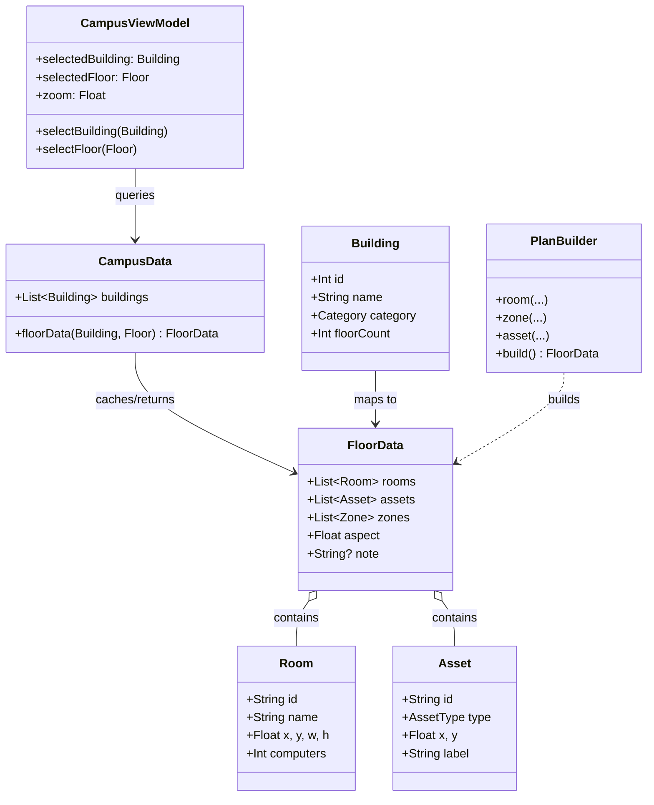

# Object-Oriented Programming (OOP) Project Documentation
## Project Name: ARASOF Campus Asset Mapping System

---

## 1. Project Overview & Objectives

### Introduction
The **ARASOF Campus Asset Mapping System** is a modern Android application developed using Kotlin and Jetpack Compose. It provides interactive 2D campus maps and detailed floor plans for buildings across the campus. The system allows students, faculty, and administrators to locate buildings, view interior layouts (ground floor, 2nd floor, 3rd floor, etc.), inspect rooms, and track campus assets such as fire extinguishers, air conditioners, Wi-Fi access points, computers, emergency lights, and fire hydrants.

### Objectives
- Provide an interactive, zoomable, and pannable visual representation of the campus map and individual building floor plans.
- Track and display asset locations (safety equipment, IT assets, fixtures) mapped to precise room coordinates.
- Demonstrate core Object-Oriented Programming (OOP) principles and architectural design patterns in Kotlin.

---

## 2. Object-Oriented Principles Implemented

The project is built following robust Object-Oriented Programming (OOP) principles and idiomatic Kotlin design patterns:

### A. Encapsulation
- **Data Encapsulation**: Core domain models—such as [`Building`](class://ph.edu.batstateu.arasof.arasofcampusassetmapping.model.Building), [`Room`](class://ph.edu.batstateu.arasof.arasofcampusassetmapping.model.Room), [`Asset`](class://ph.edu.batstateu.arasof.arasofcampusassetmapping.model.Asset), [`Zone`](class://ph.edu.batstateu.arasof.arasofcampusassetmapping.model.Zone), and [`FloorData`](class://ph.edu.batstateu.arasof.arasofcampusassetmapping.data.FloorData)—encapsulate state and properties immutably using Kotlin `data class` structures.
- **Lazy Initialization**: Floor plan data structures (`Building1Plan`, `Building3Plan`, `Building21Plan`, etc.) utilize Kotlin `by lazy` property delegation to encapsulate memory management, instantiating floor data only when accessed.

### B. Abstraction
- **`PlanBuilder` Utility**: The [`PlanBuilder`](class://ph.edu.batstateu.arasof.arasofcampusassetmapping.data.PlanBuilder) class abstracts pixel-to-fraction coordinate calculations (`fx`, `fy`), room registration, zone definitions, and asset mapping. Developers define building layouts using intuitive pixel coordinates from architectural floor plans without dealing with raw normalization math.
- **Data Access Layer Abstraction**: [`CampusData`](class://ph.edu.batstateu.arasof.arasofcampusassetmapping.data.CampusData) acts as an abstraction layer providing a unified `floorData(building, floor)` interface that hides whether the plan comes from a hardcoded architectural blueprint or a generated fallback template.

### C. Polymorphism & Enumeration
- **Enums for Type Safety**: Extensive use of enumerations (`Floor`, `Category`, `BuildingStatus`, `AssetType`, `ZoneKind`) enables polymorphic rendering and filtering across UI components. For instance, `AssetType` defines various equipment types, each carrying its own icon and label behavior when rendered on floor plans.

### D. Composition & Separation of Concerns (MVC / MVVM)
- **ViewModel Architecture**: [`CampusViewModel`](class://ph.edu.batstateu.arasof.arasofcampusassetmapping.viewmodel.CampusViewModel) separates business logic and UI state (such as selected building, active floor, zoom levels, and search queries) from the UI layer.
- **Modular UI Composables**: Reusable UI components (`ZoomPanBox`, `FloorPlanScreen`, `CampusMapScreen`, `RoomSheet`, `ReportsScreen`) adhere to composition over inheritance, ensuring high cohesion and maintainability.

---

## 3. System Architecture & Class Hierarchy

---

## 4. Key Components & File Structure

| Component Type | File Path | Description |
| :--- | :--- | :--- |
| **Domain Models** | `model/Models.kt` | Defines `Building`, `Room`, `Asset`, `Zone`, and enums (`AssetType`, `Floor`, `Category`). |
| **Data Builders** | `data/PlanBuilder.kt` | Encapsulates coordinate scaling and helper methods for building floor plans. |
| **Building Plans** | `data/Building*Plan.kt` | Concrete object definitions for individual buildings (e.g., [Building1Plan.kt](file:///C:/Users/KCignacio/AndroidStudioProjects/ARASOFcampusassetmapping/app/src/main/java/ph/edu/batstateu/arasof/arasofcampusassetmapping/data/Building1Plan.kt), [Building3Plan.kt](file:///C:/Users/KCignacio/AndroidStudioProjects/ARASOFcampusassetmapping/app/src/main/java/ph/edu/batstateu/arasof/arasofcampusassetmapping/data/Building3Plan.kt), [Building15Plan.kt](file:///C:/Users/KCignacio/AndroidStudioProjects/ARASOFcampusassetmapping/app/src/main/java/ph/edu/batstateu/arasof/arasofcampusassetmapping/data/Building15Plan.kt), etc.). |
| **Data Repository** | `data/CampusData.kt` | Central repository containing all campus building definitions and floor routing. |
| **State Management** | `viewmodel/CampusViewModel.kt` | Manages app state, user interactions, and view selections. |
| **UI Presentation** | `ui/` | Jetpack Compose screens ([CampusMapScreen.kt](file:///C:/Users/KCignacio/AndroidStudioProjects/ARASOFcampusassetmapping/app/src/main/java/ph/edu/batstateu/arasof/arasofcampusassetmapping/ui/CampusMapScreen.kt), [FloorPlanScreen.kt](file:///C:/Users/KCisingio/AndroidStudioProjects/ARASOFcampusassetmapping/app/src/main/java/ph/edu/batstateu/arasof/arasofcampusassetmapping/ui/FloorPlanScreen.kt), [ZoomPanBox.kt](file:///C:/Users/KCignacio/AndroidStudioProjects/ARASOFcampusassetmapping/app/src/main/java/ph/edu/batstateu/arasof/arasofcampusassetmapping/ui/theme/ZoomPanBox.kt), etc.). |

---

## 5. Conclusion
The **ARASOF Campus Asset Mapping System** successfully demonstrates the practical application of Object-Oriented Programming principles—specifically encapsulation, abstraction, and polymorphism—within a modern Android development environment. Through clean architectural separation between models, data builders, view models, and composable UI views, the system is scalable, maintainable, and robust.
